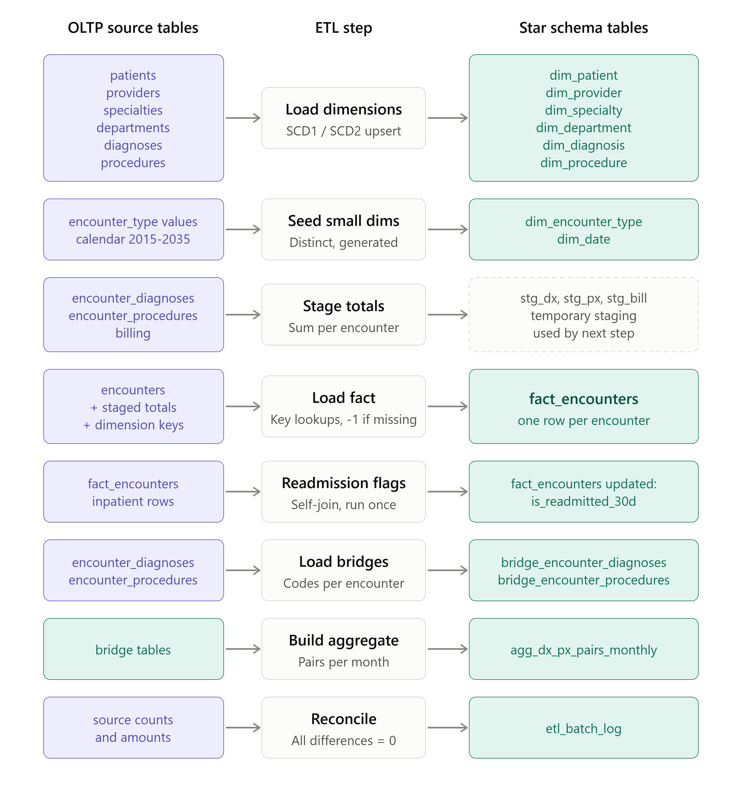
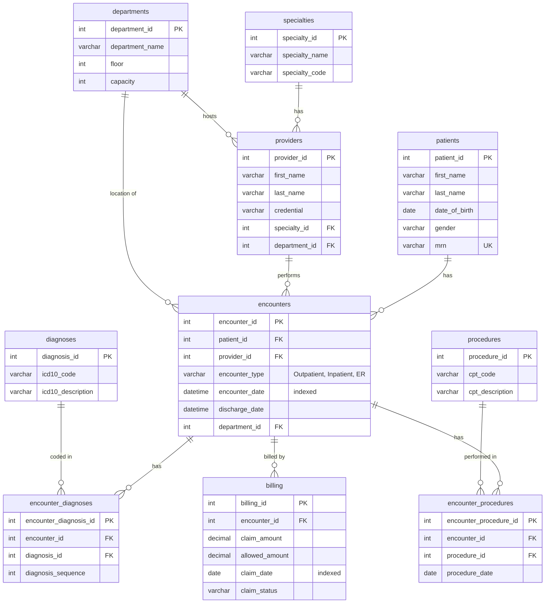
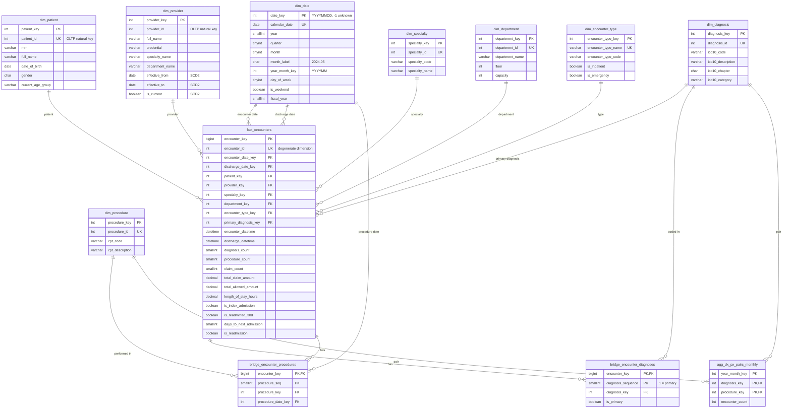

# Healthcare Analytics: OLTP to Star Schema

A data engineering mini project. HealthTech Analytics has a normalized (3NF) transactional database for clinical encounters, and its analytics queries are slow. This project measures where the OLTP schema struggles, designs a star schema to fix it, builds the ETL that loads it, and compares the two on the same data.

**Stack:** MySQL 8.0 (InnoDB), plain SQL. No application code.

## Contents

- [How the project was tested: two phases](#how-the-project-was-tested-two-phases)
- [Results at a glance](#results-at-a-glance)
- [Repository layout](#repository-layout)
- [Data flow: OLTP to star schema](#data-flow-oltp-to-star-schema)
- [ERD: OLTP schema](#erd-oltp-schema)
- [ERD: star schema](#erd-star-schema)
- [The four business questions](#the-four-business-questions)
- [How to run it](#how-to-run-it)
- [Key findings](#key-findings)
- [Limitations](#limitations)

## How the project was tested: two phases

Every query was run against both schemas in two phases. The reason is that the small sample hides the problem entirely.

| | Phase 1: small data | Phase 2: large data |
|---|---|---|
| **Dataset** | The sample from the project brief | The sample plus 100,000 synthetic encounters (2022–2026) |
| **Encounters** | 4 | 100,004 |
| **Patients** | 3 | 10,003 |
| **Encounter diagnoses / procedures / claims** | 6 / 4 / 2 | 200,006 / 100,004 / 100,002 |
| **Providers, specialties, diagnoses, procedures** | 3 each | 3 each |
| **Purpose** | Check that each query runs and returns the right rows | Measure realistic cost and find the bottlenecks |
| **Timer** | MySQL `EXPLAIN ANALYZE` (server time, in ms) | MySQL Workbench duration, median of 4–5 runs. `EXPLAIN ANALYZE` is used where Workbench is too coarse |
| **Loaded by** | `02_sample_data.sql` | `02_sample_data.sql` + `generate_healthcare_bigdata.sql`, then the ETL (about 24 s) |

On 4 encounters every OLTP query finished in under 1 ms, so no bottleneck was visible, and the optimizer chooses differently on tiny tables anyway. Phase 2 is the one that exposes the real costs, and it is the one used for the improvement factors. In Phase 2 every star schema query returned the same results as its OLTP counterpart, and the ETL's reconciliation checks showed 0 difference.

## Results at a glance

### Phase 2: large data (100,004 encounters)

| Business question | OLTP | Star schema | Speedup | Main reason |
|---|---|---|---|---|
| Q1. Monthly encounters by specialty | 0.40 s | 0.094 s | **4.3×** | Specialty key stored on the fact row, covering index, integer month key |
| Q2. Top diagnosis–procedure pairs | 2.75 s | < 0.016 s | **> 170×** | The 266,673-row diagnosis × procedure pairing is computed once by the ETL |
| Q3. 30-day readmission rate | 0.73 s | ~0.016 s | **~28–46×** | Self-join replaced by a pre-computed `is_readmitted_30d` flag |
| Q4. Revenue by specialty and month | 0.89 s | 0.125 s | **7.1×** | Billing totals stored on the fact row, so the 4-table join chain is gone |

### Phase 1: small data (4 encounters)

| Business question | OLTP | Star schema | Result |
|---|---|---|---|
| Q1. Monthly encounters by specialty | 0.123 ms | 0.175 ms | 1.4× slower |
| Q2. Top diagnosis–procedure pairs | 0.228 ms | 0.957 ms | 4.2× slower |
| Q3. 30-day readmission rate | 0.682 ms | 0.322 ms | 2.1× faster |
| Q4. Revenue by specialty and month | 0.247 ms | 0.275 ms | 1.1× slower |

**What the two phases show:** with 4 rows, the star schema was slower for three of the four queries, because the fixed cost of joining dimension tables outweighs any saving. With 100,004 rows it was faster for all four. Dimensional modelling pays off with volume, not by default. Phase 1 alone would wrongly suggest it does not help. The two phases use different timers, so growth ratios between them are approximate. See [analysis/reflection.md](analysis/reflection.md) for the full discussion.

## Repository layout

```
healthcare-analytics/
├── sql/
│   ├── 01_oltp_schema.sql              OLTP schema (10 normalized tables)
│   ├── 02_sample_data.sql              Sample rows from the project brief (Phase 1)
│   ├── generate_healthcare_bigdata.sql Synthetic load generator, ~100,000 encounters (Phase 2)
│   ├── 03_oltp_analysis_queries.sql    The 4 business questions on the OLTP schema
│   ├── 04_star_schema.sql              Star schema DDL (dimensions, fact, bridges, aggregate)
│   ├── 05_star_schema_queries.sql      The same 4 questions on the star schema
│   └── 06_etl_load.sql                 Full-refresh ETL from OLTP to star schema
├── analysis/
│   ├── query_analysis.txt              Part 2: OLTP query analysis and bottlenecks
│   ├── design_decisions.txt            Part 3.1: star schema design choices
│   ├── star_schema_queries.txt         Part 3.3: optimized queries and comparison
│   ├── etl_design.txt                  Part 3.4: ETL design and refresh strategy
│   ├── reflection.md                   Part 4: trade-offs and performance analysis
│   └── data_quality_notes.txt          DATETIME vs DATE issue found in the sample data
└── results/
    ├── oltp_to_star_schema_etl_dataflow.png  ETL data flow diagram
    ├── oltp_query_results/             Screenshots of each OLTP query run
    ├── star_schema_query_results/      Screenshots of each star schema query run
    └── performance_comparison.xlsx     Timing comparison table
```

## Data flow: OLTP to star schema

The ETL ([sql/06_etl_load.sql](sql/06_etl_load.sql)) reads the normalized `healthcare_analytics` database and loads `healthcare_analytics_dw` in eight steps. Each row of the diagram is one step: OLTP source on the left, ETL action in the middle, star schema target on the right.



1. **Load dimensions:** patients, providers, specialties, departments, diagnoses and procedures are upserted into their dimensions (SCD1, with SCD2 for providers).
2. **Seed small dimensions:** `dim_encounter_type` from the distinct encounter types, and `dim_date` generated for 2015–2035.
3. **Stage totals:** diagnosis, procedure and billing totals are summed per encounter into temporary staging tables.
4. **Load fact:** one `fact_encounters` row per encounter, with surrogate key lookups. A missing key becomes `-1` (the Unknown member).
5. **Readmission flags:** the 30-day self-join is run once and stored as `is_readmitted_30d`.
6. **Load bridges:** one row per encounter–diagnosis and encounter–procedure link.
7. **Build aggregate:** `agg_dx_px_pairs_monthly` is built from the bridges.
8. **Reconcile:** encounter count, allowed amount, diagnosis links and procedure links are compared with the source. All differences must be 0, and the batch is recorded in `etl_batch_log`.

## ERD: OLTP schema

Database `healthcare_analytics`: 10 tables in 3NF. Specialty is reachable only through the provider (`encounters → providers → specialties`), and diagnoses and procedures hang off `encounters` through two separate junction tables. Those two facts cause most of the performance problems measured in Phase 2.



## ERD: star schema

Database `healthcare_analytics_dw`. The grain of `fact_encounters` is one row per encounter. Specialty, department and encounter type sit directly on the fact row, as they were at the time of the encounter. Billing, counts and readmission flags are pre-computed by the ETL. The two bridge tables hold the many-to-many diagnosis and procedure links, and `agg_dx_px_pairs_monthly` is built from them for Q2.



The warehouse also has `etl_batch_log`, a standalone watermark and audit table that is not related to the others by foreign key.

Design notes:

- **Pre-computed measures on the fact row:** diagnosis and procedure counts, claim count and amounts, length of stay, age at encounter and the readmission flags.
- **Dimensions:** the provider dimension is SCD Type 2, so history stays attributed to the specialty a provider had at the time. The rest are SCD Type 1.
- **Keys:** `date_key` is an integer `YYYYMMDD`, and every dimension has an Unknown member with key `-1`, so fact foreign keys are never NULL.
- **Covering indexes** on the fact table serve Q1, Q3 and Q4.

## The four business questions

1. **Monthly encounters by specialty:** total encounters and unique patients per month, specialty and encounter type.
2. **Top diagnosis–procedure pairs:** the most common ICD-10 / CPT combinations, by encounter count.
3. **30-day readmission rate:** which specialty has the highest rate. An index admission is an inpatient encounter with a discharge date. It counts as readmitted if the same patient has another inpatient encounter starting within 30 days after that discharge.
4. **Revenue by specialty and month:** total allowed amount, attributed to the month the care was provided.

For each one, [analysis/query_analysis.txt](analysis/query_analysis.txt) documents the OLTP query, tables joined, timing and bottleneck, and [analysis/star_schema_queries.txt](analysis/star_schema_queries.txt) documents the star schema version and why it is faster.

## How to run it

**Prerequisites:** MySQL 8.0 or later (the scripts use recursive CTEs and window functions) and a client such as MySQL Workbench or the `mysql` CLI.

Run the scripts from `sql/` in this order. Skip step 3 to reproduce Phase 1 only; include it for Phase 2.

| Step | Script | What it does |
|---|---|---|
| 1 | `01_oltp_schema.sql` | Creates `healthcare_analytics` and its 10 tables |
| 2 | `02_sample_data.sql` | Loads the 4-encounter sample from the brief (Phase 1) |
| 3 | `generate_healthcare_bigdata.sql` | *Phase 2.* Appends ~100,000 synthetic encounters |
| 4 | `03_oltp_analysis_queries.sql` | Runs the four OLTP queries |
| 5 | `04_star_schema.sql` | Creates `healthcare_analytics_dw` and its tables |
| 6 | `06_etl_load.sql` | Loads the warehouse from the OLTP database |
| 7 | `05_star_schema_queries.sql` | Runs the four star schema queries |

With the CLI:

```bash
cd sql
mysql -u <user> -p < 01_oltp_schema.sql
mysql -u <user> -p < 02_sample_data.sql
mysql -u <user> -p < generate_healthcare_bigdata.sql   # Phase 2 only
mysql -u <user> -p < 04_star_schema.sql
mysql -u <user> -p < 06_etl_load.sql
mysql -u <user> -p < 03_oltp_analysis_queries.sql
mysql -u <user> -p < 05_star_schema_queries.sql
```

Notes:

- The generator appends rows and does not delete anything. Run it only against a development copy.
- The ETL is a **full refresh**. It truncates the warehouse tables first, so it is safe to re-run. It also runs reconciliation checks at the end (encounter count, allowed amount, diagnosis links and procedure links), which should all return 0.
- On the large dataset the ETL takes about 24 seconds. In MySQL Workbench, raise the read timeout under *Edit → Preferences → SQL Editor → DBMS connection read timeout* (for example, 600) and reconnect.
- The ETL script sets `sql_safe_updates = 0` for its session, because Workbench's default blocks its multi-table `UPDATE`s.
- To measure server-side time, prefix a query with `EXPLAIN ANALYZE`. Workbench's duration counter has about 16 ms resolution on Windows, so very fast queries show as 0.000 or 0.016 s.

## Key findings

- **Why OLTP is slow here:** every query reads all encounters and walks the same join chain to find the specialty. Derived answers (diagnosis–procedure pairs, readmissions, billing totals) are recomputed on every run.
- **Why the star schema is faster:** it removes joins by stamping the specialty on the fact row. It lets one composite index cover a query. It also moves the expensive work (pairing, self-join, billing sums) into the ETL, where it runs once per load instead of once per report.
- **Biggest wins come from pre-computation**, not from removing joins alone. Q2 and Q3 gained the most; Q1 and Q4 gained 4–7×.
- **Bridge tables keep detail but do not make pair queries fast.** Joining both bridges at query time still explodes the rows. The monthly aggregate is what delivers the speedup.
- **Cost of the design:** the warehouse duplicates the OLTP data (about 72 MB each), the fact table's indexes are about three times the size of its data, and reports are only as fresh as the last load.

## Limitations

- The data is synthetic: 3 providers, 3 specialties, 3 diagnoses and 3 procedures. Aggregate sizes and speedups would differ with real ICD-10 and CPT code volumes.
- No patient in the synthetic data returns within 30 days, so Q3 returns 0% in both schemas. The timings are valid, but the result is not a clinical finding.
- Phase 1 and Phase 2 use different timers, so growth ratios between phases are approximate. Absolute times depend on hardware. The ratios and the reasons behind them are the main result.
- Only a full-refresh load is implemented. Incremental loading and late-arriving data are described in [analysis/etl_design.txt](analysis/etl_design.txt) but not built.

## Further reading

Start with [analysis/reflection.md](analysis/reflection.md) for the summary, then [analysis/design_decisions.txt](analysis/design_decisions.txt) and [analysis/etl_design.txt](analysis/etl_design.txt) for the reasoning behind the schema and the load process.
